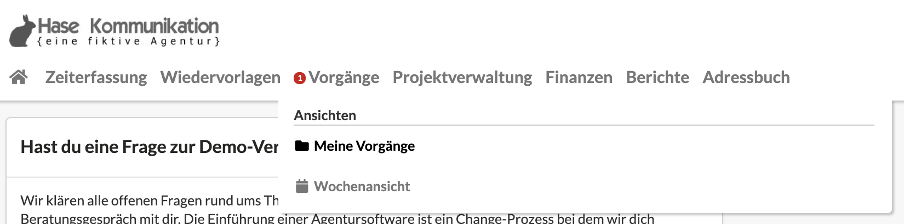
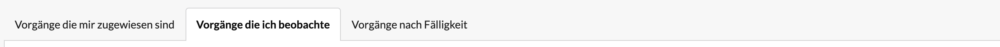
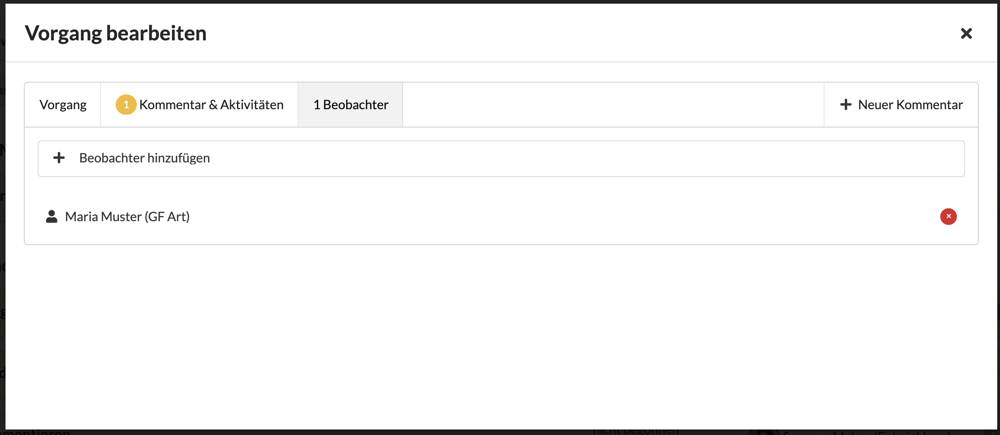

# Aufgaben, die ich beobachte

Eine Übersicht über alle von mir beobachteten Aufgaben erhalte ich im Reiter "Aufgaben, die ich beobachte" auf der Seite "Aufgaben", welche ich über die Navigation erreiche.

> Die Beobachtungsfunktion ist vor allem für Projektleiter und Führungskräfte konzipiert, um einen Überblick über alle Aufgaben eines Projektes oder eines Teams zu erhalten.

Neben der Auflistung der von mir beobachteten Aufgaben im entsprechenden Reiter erhalte ich auch Benachrichtigungen, z.B. wenn sich der Status einer Aufgabe ändert, beispielsweise weil sie geschlossen wurde, oder wenn ein Kommentar hinzugefügt wird.

### Wie beobachte ich eine Aufgabe?

#### Aufgabe einem anderen Nutzer zuweisen

Hat man eine Aufgabe erstellt und weist diese zur weiteren Bearbeitung einem anderen Nutzer zu, wird der Autor der Aufgabe automatisch zum Beobachter. So behält der Autor die Aufgaben, die delegiert wurden, weiterhin im Blick.

#### Sich als Beobachter eintragen

Um eine Aufgabe zu beobachten, öffnet man die Aufgabe zur Bearbeitung durch einen Klick darauf. Im Reiter "Beobachter" werden alle Benutzer aufgelistet, welche diese Aufgabe bereits beobachten.

Mit Hilfe des Auswahl-Elements "+ Benutzer hinzufügen" kann ich mich selbst oder einen anderen Benutzer zur Beobachtung dieser Aufgabe hinzufügen.

#### Als Beobachter keine weiteren Benachrichtigungen erhalten

Möchte man eine Aufgabe nicht weiter beobachten, um keine weiteren Benachrichtigungen zu Kommentaren und Änderungen dieser Aufgabe zu erhalten, kann man sich als Beobachter auch löschen, indem man sich im Reiter "Beobachter" der jeweiligen Aufgabe aus der Liste der Beobachter entfernt.

