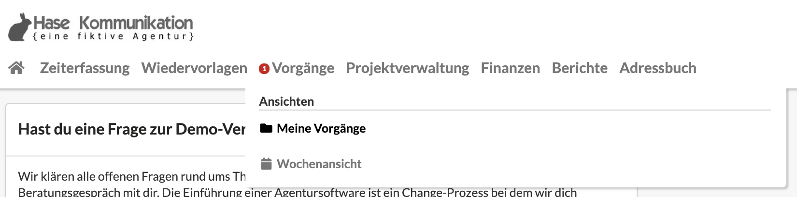
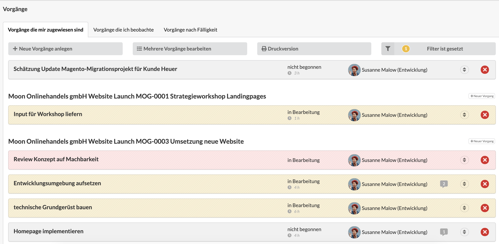
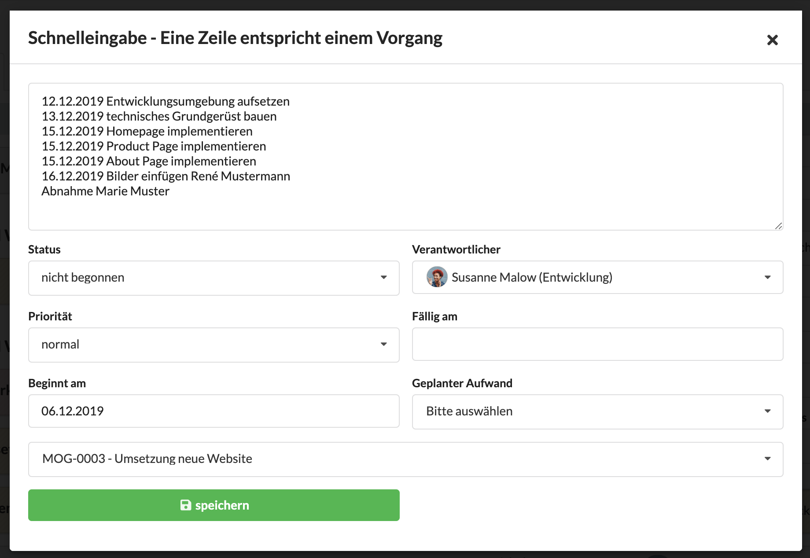
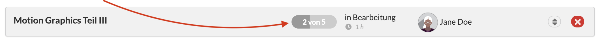
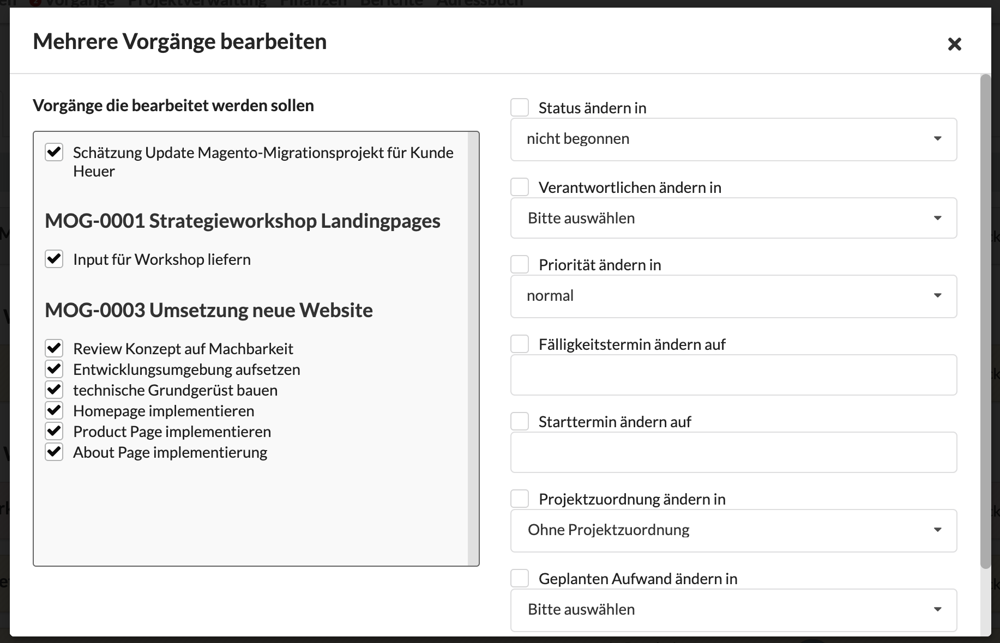
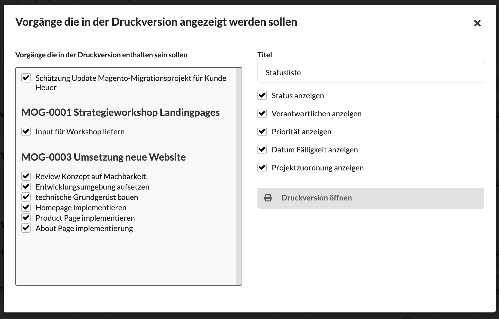
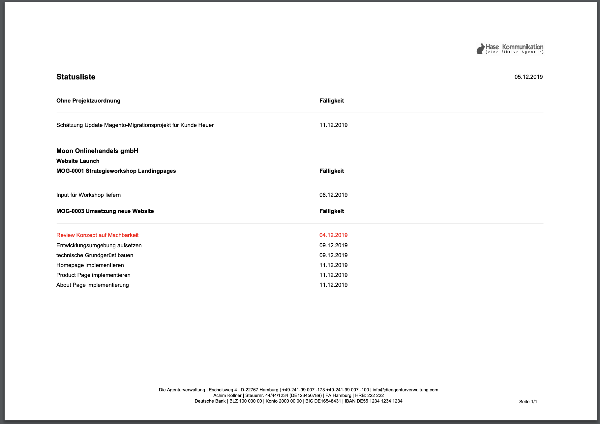
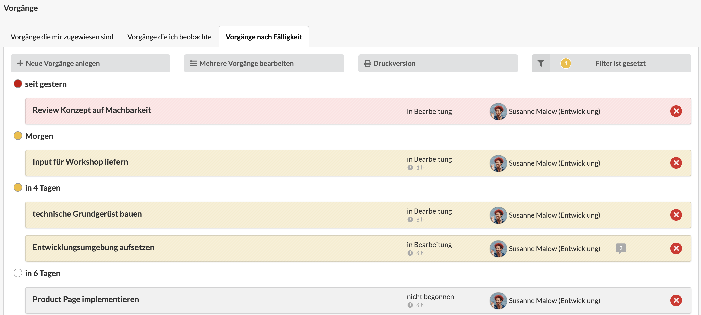
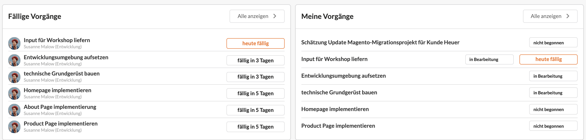

# Meine Aufgaben

Eine Übersicht über alle mir zugewiesenen Aufgaben erhalte ich auf der Seite "Meine Aufgaben", welche ich über die Navigation erreichen kann.

Die Übersichtsseite ist nach Projekten gegliedert und kann innerhalb der Projekte mit Hilfe des -Buttons sortiert werden. Farblich hervorgehoben werden Aufgaben, die in wenigen Tagen fällig sind (orangener Hintergrund) und deren Frist bereits abgelaufen ist (roter Hintergrund).

Über den Filter-Button  oberhalb der Übersicht können Filter auf die Ansicht konfiguriert werden, um bspw. nur Aufgaben mit hoher Priorität anzuzeigen.

Unterhalb der Aufgabenliste wird der _Geschätzte Gesamtaufwand,_ also die Summe aller an den Aufgaben hinterlegten Aufwänden, angezeigt.\
.png>)&#x20;


**Aufgaben eignen sich nicht für private oder vertrauliche Notizen!**\
Selbst wenn eine Aufgabe nur für den Autor angelegt ist, ist sie im Projekt und - sofern sie über ein Startdatum verfügt - auch in der Wochenansicht der Aufgaben samt aller Kommentare für diejenigen Nutzer sichtbar, die Zugriff auf die Wochenansicht der Aufgaben des Teams oder die Aufgaben des entsprechenden Projekts haben.


### Erstellen von Aufgaben

Mit einem Klick auf den Button "+ neue Aufgabe anlegen" kann eine Aufgabe angelegt werden.

Das Auswahlfeld direkt rechts am Schalter erlaubt auch das Erstellen mehrerer Aufgaben über den Schnelleingabe-Wizard:

In dem großen Freitextfeld können gleich mehrere Aufgaben zeilenweise angelegt werden. Dabei kann durch Angabe eines Datums direkt die Fälligkeit gesetzt und durch Angabe eines Benutzernamens (René Mustermann und Maria Muster im Beispiel) eine Zuordnung der Verantwortlichkeit vorgenommen werden.

Die Werte der anderen Felder (Status, Priorität, Beginnt am, Projekt) werden an allen Aufgaben hinterlegt.&#x20;

Mit Klick auf den Speichern-Button werden die Aufgaben angelegt.

###

### Aufgaben aus Positionen eines Kostenvoranschlags erzeugen

Im Auswahlfeld "Neue Aufgabe" gibt es auch die Option "Aufgaben aus KV-Positionen erstellen". Hier kann ein Kostenvoranschlag gesucht und ausgewählt werden. Im nächsten Schritt werden dann Positionen dieses KVs ausgewählt und mit einem Klick in Aufgaben umgewandelt.&#x20;

Befindet sich der Nutzer in der Liste der Aufgaben eines Projekts, werden diese Aufgaben in diesem Projekt angelegt. Ansonsten im Projekt des ausgewählten Kostenvoranschlags. Liegt auch hier kein Projekt vor, so werden die Aufgaben ohne Projekt erzeugt.

[https://youtu.be/cxFMR1vE-wA](https://youtu.be/cxFMR1vE-wA)

### Zeit an Aufgaben erfassen

Innerhalb eines Projekts kann Zeit auch an Aufgaben erfasst werden. Dazu legt man eine Aufgabe an und aktiviert den Schalter "Aufgabe für die Zeiterfassung zur Verfügung stellen".

Im Zeiterfassungsdialog wird dann nach der Auswahl des Projekts abgefragt, zu welcher Aufgabe der Zeiterfassungseintrag gehört:



An Aufgaben erfasste Zeiten können im Reiter "Agenturleistungen" eines Kunden, Etats oder Projekts ausgewertet werden.

### Bearbeiten von Aufgaben

Zur Bearbeitung einer Aufgabe wird diese einfach angeklickt. In der Bearbeitungsmaske können alle Felder angepasst oder aktualisiert werden.

**Dokumente hochladen**

Im Tab "Dokumente" können Datei-Anhänge zu dieser Aufgabe per Drag & Drop hinzugefügt werden.

### Checkliste, um den Fortschritt einer Aufgabe zu erkennen

Aufgaben verfügen über ein Beschreibungsfeld. Dieses kann zum einen genutzt werden, um nützliche Informationen, z.B. ein Briefing, weiterführende Links oder eine Checkliste, ähnlich einer Todo-Liste zu hinterlegen.


Eine Checkliste entsteht automatisch, wenn in der Beschreibung der Aufgabe folgende Syntax verwendet wird:

`Folgendes bitte umsetzen`\
`[x] Briefing erstellen`\
`[x] Motivauswahl`\
`[ ] TouchUp Motive`\
`[ ] Interne Abstimmung`\
`[ ] Motiv-Versand`


Die Agenturverwaltung erkennt an den eckigen Klammern im Fliesstext automatisch, dass es sich um ein Checklistenelement handelt.

Der Status der Checkliste dieser Aufgabe wird in der Aufgabenübersicht dann mit einem Fortschrittsbalken angezeigt, aus dem zu erkennen ist, wie viele Teilaufgaben der Aufgabe bereits erledigt wurden:

### Dokumentenanhänge in Aufgaben

Zu Aufgaben können auch Dokumente per Drag & Drop hochgeladen werden, das können beispielsweise Briefing-Informationen oder Materialen für die Umsetzung sein.

### Stapelverarbeitung: Gleichzeitig mehrere Aufgaben bearbeiten

Eine Mehrfachbearbeitung ist über den Button "Mehrere Aufgaben bearbeiten"möglich. Im sich öffnenden Stapelverarbeitungsdialog können links die zu bearbeitenden Aufgaben ausgewählt werden. Auf der rechten Seite werden dann die anzupassenden Felder durch die Check-Box zur Bearbeitung markiert und anschließend mit einem neuen Wert belegt.

### Erstellung von Statuslisten mit der Druckfunktion

Mit Hilfe der Druck-Funktion  kann mit wenigen Klicks auf eine Statusliste im Briefpapier-Design der Agentur erstellt werden. Die anzuzeigenden Daten sind dabei im Druck-Wizard konfigurierbar.

Eine Statusliste in der Druckvorschau sieht zum Beispiel wie folgt aus. Über die Konfiguration des Briefpapiers kann die Druckversion individuell gestaltet werden. Mehr zum Thema Briefpapier erfährst du [hier](../erste-schritte-1/grundeinstellungen/briefpapier-anpassen.md).

### Tipp: Ansicht der Aufgaben nach Fälligkeit

Neben der Standardansicht, welche in Projekten gruppiert und individuell sortiert ist, kann über den Reiter "Aufgaben nach Fälligkeit" zu einer alternativen Ansicht navigiert werden.

Hier werden deine eigenen Aufgaben und die Aufgaben anderer Nutzer die du beobachtest, nach Fälligkeit sortiert angezeigt. Dies ist hilfreich, um die Deadlines verschiedener Aufgaben projektübergreifend im Blick zu behalten.

### Tipp: Relevante Aufgaben auf dem Dashboard

Einen guten Überblick über aktuell relevante Aufgaben erhält man auch auf dem persönlichen Dashboard. In zwei Widget werden zum einen alle für mich freigegebenen, **fälligen Aufgaben,** sortiert nach ihrer Fälligkeit, angezeigt. Dies hilft jene Aufgaben zu identifizieren, welche aktuell deine Aufmerksamkeit benötigen. In dem zweiten Widget "**Meine Aufgaben**" werden alle mir zugewiesenen Aufgaben, gemäß ihrer Sortierung im Reiter "Meine Aufgaben" angezeigt. Über den "Alles anzeigen >"-Button jeweils oben rechts im Widget gelangt man zur Übersichtsseite.


**Aufgaben für Standardprozesse bei wiederkehrenden Projekten**\
Die Agenturverwaltung erlaubt auch die Konfiguration von Standardprojekten, die z.B. einem wiederkehrenden Ablauf folgen und bei deren Initialisierung gleich eine Reihe von Aufgaben erstellt werden sollen.&#x20;

Sollte das bei eurem Unternehmen der Fall sein, sprecht uns an: \
info@dieagenturverwaltung.de

