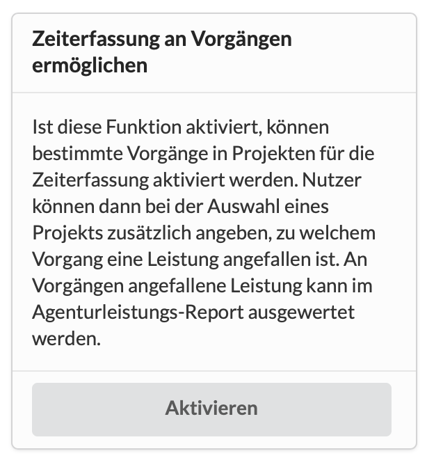

# Zeiterfassung an Aufgaben

In einem grösseren Projekt kann es Sinn machen, Zeiten nicht nur generell auf das Projekt zu erfassen, sondern Aufgaben anzulegen, die Teilabschnitte, Milestones oder konkrete Arbeitspakete in diesem Projekt repräsentieren.

So lässt sich nicht nur auswerten, wieviel Arbeitszeit im gesamten Projekt angefallen ist, sondern auch auf welchen Abschnitten des Projekts. Dadurch ergibt sich ein wesentlich transparenteres Bild.

In den Einstellungen kann generell die Möglichkeit geschaffen werden diese Option zu aktivieren.

Dadurch erscheint an jeder Aufgabe eine Checkbox "Diese Aufgabe in der Zeiterfassung zur Verfügung stellen". Das bedeutet, du kannst auch nur bestimmte Aufgaben für die Zeiterfassung aktivieren.

Wie das geht, erfährst Du hier:





